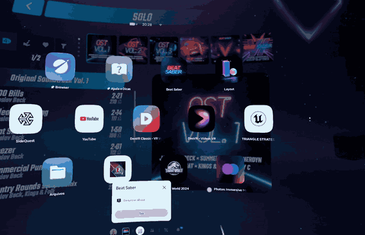
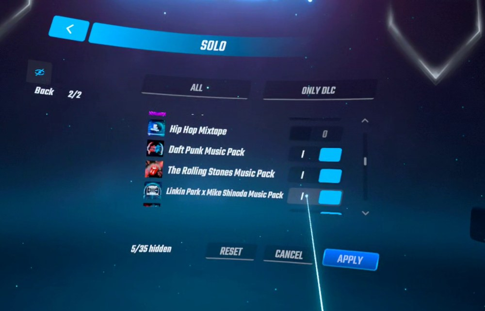
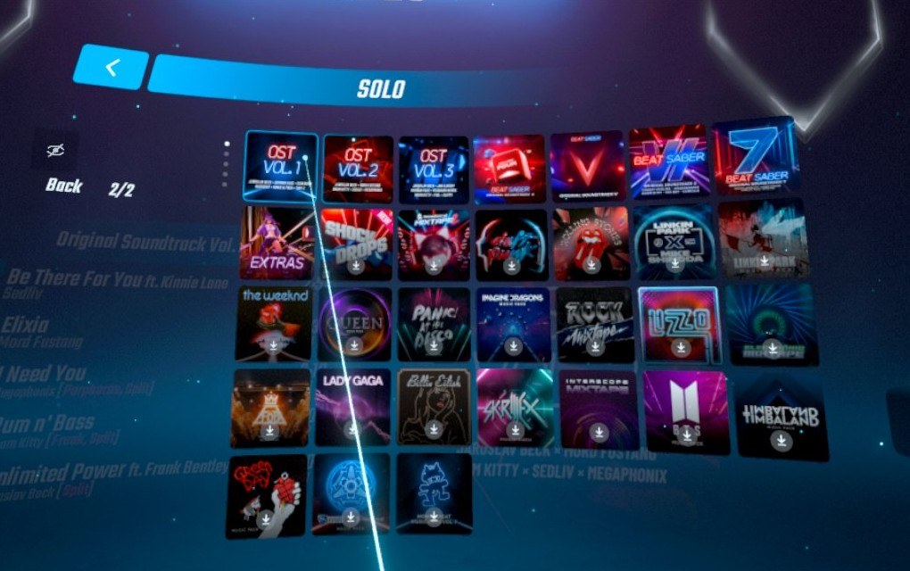

<h1 align="center">HidePacks</h1>

<p align="center">
  <b>Hide the official packs you never play</b><br>
  A new eye tab in the Beat Saber solo menu, for Quest
</p>

<p align="center">
  
  
  
</p>

<p align="center">
  <a href="https://ko-fi.com/thiagoand"></a>
</p>

<p align="center">
  
</p>

## What it does

- Adds an **eye tab** to the Solo category bar with every official pack, its cover and a switch
- Turn a pack off, press **Apply**, and it is gone from the pack list
- Your choice is saved and kept between sessions
- Custom songs, custom packs and playlists are never touched

<p align="center">
  
  
</p>

## How to use

| Button | What it does |
|---|---|
| **All** / **Only DLC** | Filters the list you see, switches stay as they are |
| **Reset** | Turns every switch on |
| **Cancel** | Goes back to what is saved |
| **Apply** | Saves and takes effect right away |

At least one pack has to stay visible.

## Install

Add `HidePacks.qmod` from the [releases](../../releases) to MBF. It needs [CategoryTabs](https://github.com/ThiagoAnd/Quest.CategoryTabs), and MBF installs it for you.

## Versions

- [Releases](../../releases) with the download of each version
- [Changelog](CHANGELOG.md) with what changed in each one

## Config

Hidden packs are saved in `/sdcard/ModData/com.beatgames.beatsaber/Configs/HidePacks.json`:

```json
{"hidden": ["OstVol1", "Camellia"]}
```

You can edit it by hand. Ids for 1.40.8 are `OstVol1` to `OstVol7`, `Extras`, `Camellia` and the DLC ones such as `Monstercat`, `LinkinPark`, `LinkinPark2` or `ShockDrop`.

## Without CategoryTabs

The eye tab does not appear and no pack is hidden, so nothing stays hidden with no way to undo it. The log says so.

## Problems

Send `/sdcard/ModData/com.beatgames.beatsaber/logs2/HidePacks.log`.
Errors start with `HIDEPACKS ERROR`.

## Support

If this mod made your game better and you would like to see more from me, you can support my work on [Ko-fi](https://ko-fi.com/thiagoand). Thank you!

## Credits

Made by **ThiagoAnd**
Tabs and paging by [CategoryTabs](https://github.com/ThiagoAnd/Quest.CategoryTabs)

## License

GPL-3.0, see [LICENSE](LICENSE)
